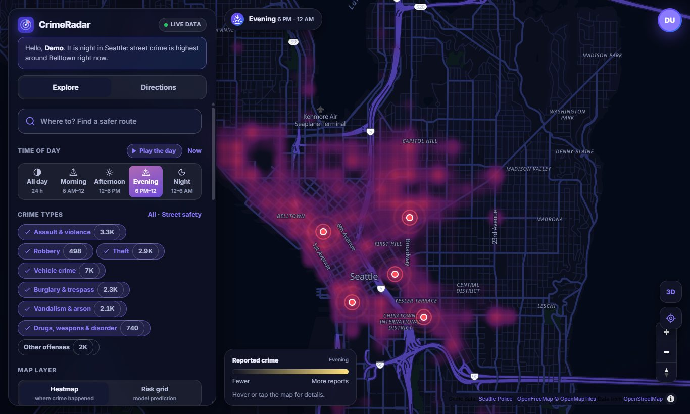
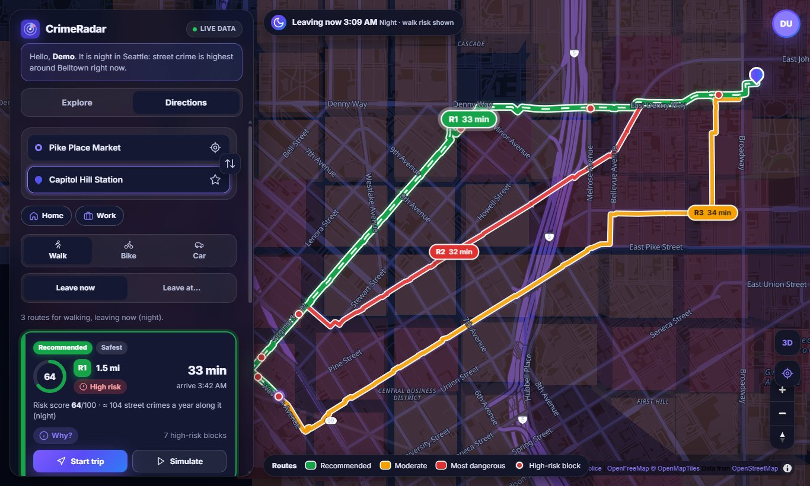
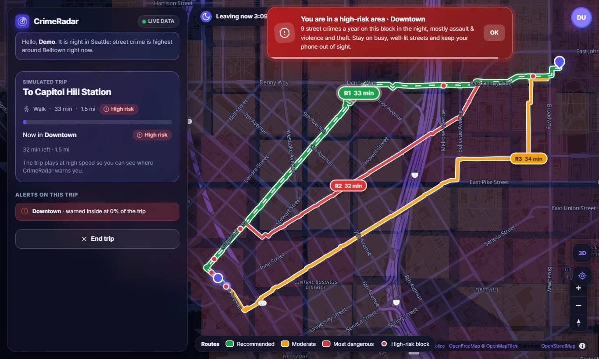
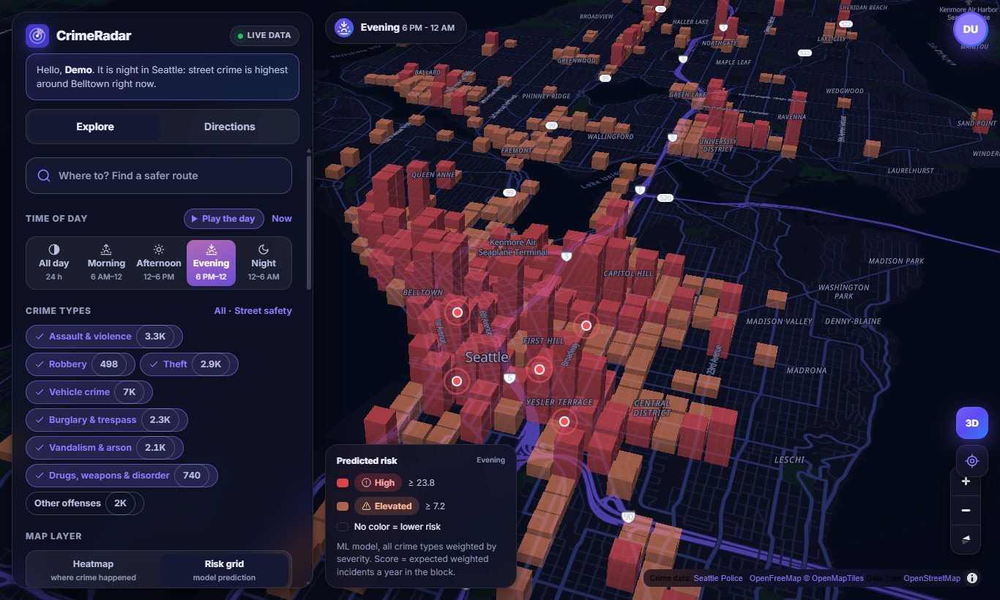
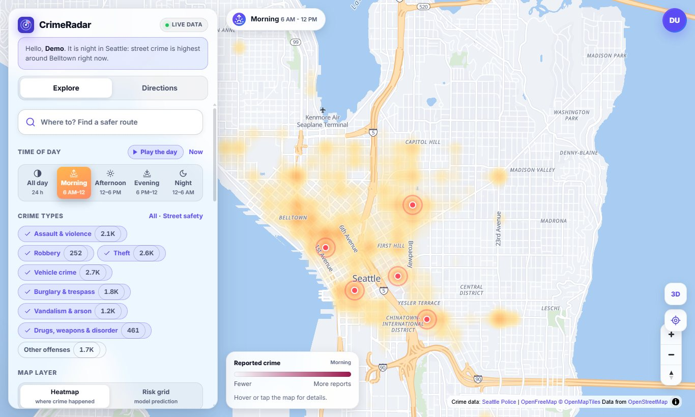
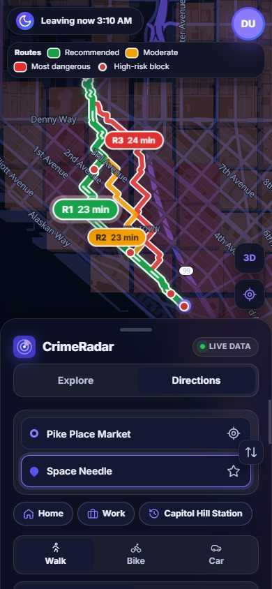

# CrimeRadar

**Turning Seattle Police data into safer times, places and routes.**

CrimeRadar is a Seattle crime-safety web app built on a MySQL relational model of
the last 4 years of Seattle Police Department (SPD) offense reports (about 319,000 rows,
285,817 after cleaning). It shows a crime heatmap by time of day, ranks neighborhoods from
most to least dangerous, predicts the risk of every city block with a machine-learning model,
suggests the safer route for walking, biking or driving at the time you travel, and warns you
before you enter a high-risk block.

Team project for **CS 5200 Database Management Systems** at Northeastern University.



| Safe routes with risk scores | Danger alert during a trip |
|---|---|
|  |  |

| 3D risk skyline (ML prediction per block) | Daylight palette | Phone |
|---|---|---|
|  |  |  |

## Features

| Feature | What it does |
|---|---|
| **Beautiful live map** | A vector map (MapLibre GL + OpenFreeMap, no API key) in CrimeRadar's own daylight and midnight palettes, which fade into each other. **3D** tilts the city and raises the risk blocks into a skyline. Pulsing radar blips mark the riskiest blocks. A raster map (Leaflet) takes over when WebGL is missing. |
| **Crime heatmap** | A GPU heatmap of where crime was reported, for All day, Morning, Afternoon, Evening or Night, and for the crime types you pick. **Play the day** animates a full day. The whole app turns dark for evening and night. |
| **Areas ranked** | 58 neighborhoods ranked by a danger index (severity-weighted incidents per year per km²). |
| **ML risk model** | Gradient boosting (Poisson) predicts next-year risk for each ~225 m block and time band. On the held-out last year it beats simple history on every metric (see [ml/MODEL_CARD.md](ml/MODEL_CARD.md)). |
| **Time-aware safe routes** | Up to 3 routes (R1-R3) from OSRM on the map at once: **green = recommended, orange = moderate, red = most dangerous**. Each is scored for your departure time and travel mode (walking is the most exposed). **Why?** explains the score. |
| **Danger alerts** | During a trip, a warning before you enter a high-risk block (banner, sound, vibration). **Simulate** plays a trip for demos. |
| **Accounts** | Sign in first. Saved Home, Work and favorite places, usual travel mode, a "safety vs speed" slider, and trip history, all stored in MySQL. |
| **Live or offline** | With Tomcat + MySQL the app shows **Live data**. Without a server, it runs on static JSON files and keeps the account in the browser. |

Read the [user guide](docs/USER_GUIDE.md) (with a 5-minute exhibition demo script).

## Quick start

### A. UI only (no database, 1 command)

```powershell
python tools/serve_ui.py
```

Open <http://localhost:5500/> and click **Explore with the demo account**.

### B. Full app (MySQL 8 + Tomcat 9 + Java 17+)

1. Get the data (about 72 MB, the last 4 years):
   ```powershell
   python pipeline/fetch_spd.py
   ```
2. Build the database (asks for your MySQL root password):
   ```powershell
   & "C:\Program Files\MySQL\MySQL Server 8.0\bin\mysql.exe" --local-infile=1 -u root -p -e "source sql/crime_radar_all.sql"
   ```
3. Copy `CrimeRadar/src/main/java/db.properties.example` to `db.properties` in the same folder and set your MySQL password. The file is git-ignored.
4. Build the app tables, import the ML output and create the demo account:
   ```powershell
   .\scripts\setup-db.ps1
   ```
5. Run the app on Tomcat 9:
   ```powershell
   .\scripts\run-tomcat.ps1
   ```
   Open <http://localhost:8080/CrimeRadar/>. Demo login: `demo@crimeradar.app` / `CrimeRadar2026!` (a public test account).
   The scripts find Tomcat 9 through `CATALINA_HOME`, the Windows installer folder, or an `apache-tomcat-9.*` folder in Downloads. For another folder, add `-TomcatHome <folder>`.

Eclipse still works: **Run As > Run on Server** (Tomcat 9) opens the same app.
Before you re-run `crime_radar_all.sql` on a database that already has the app tables, run `.\scripts\setup-db.ps1 --drop-only`.

### Keep the data fresh

`.\scripts\sync.ps1` fetches new SPD reports into MySQL. `-Retrain` also retrains the model and
rebuilds the static files. The script header shows how to schedule it twice a day with Task Scheduler.
See [docs/DATABASE.md](docs/DATABASE.md).

## How it works

```
SPD open data --> pipeline/fetch_spd.py --> CSV --> sql/crime_radar_all.sql --> MySQL
                                             |                                   |
                                             +--> ml/train_risk_model.py --------+ (CellRiskScores)
MySQL --> Java servlets (/api) --> browser UI (Leaflet) --> OSRM routes, Photon search
```

| Document | Content |
|---|---|
| [docs/ARCHITECTURE.md](docs/ARCHITECTURE.md) | Components, modules, navigation, risk method, external services, security |
| [docs/API.md](docs/API.md) | Contract between UI, backend and pipeline (JSON shapes, constants) |
| [docs/DATABASE.md](docs/DATABASE.md) | All tables, ER diagram, indexes, what data is ignored and why |
| [ml/MODEL_CARD.md](ml/MODEL_CARD.md) | Model, features, test metrics, limits |
| [pipeline/README.md](pipeline/README.md) | Rebuild the data, the model and the static files |
| [docs/USER_GUIDE.md](docs/USER_GUIDE.md) | How to use the app; exhibition demo script |

## Repository layout

| Path | What it is |
|---|---|
| [`sql/crime_radar_all.sql`](sql/crime_radar_all.sql) | Builds the `CrimeRadar` database: tables, loads and cleans the SPD CSV (last 4 years), sample rows for the supporting tables, row counts |
| [`sql/app_tables.sql`](sql/app_tables.sql) | App layer: crime groups, grid cells, summary tables, ML risk, users' places, preferences and trips |
| [`sql/milestone3_business_queries.sql`](sql/milestone3_business_queries.sql) | The 11 business-insight queries (Milestone 3) |
| [`CrimeRadar/`](CrimeRadar) | Java web app (Eclipse Dynamic Web Project): JDBC data layer, `/api` servlets, the UI in `src/main/webapp`, and the server-side route recommender (`crimeradar.recommendation`, `/recommend`) |
| [`pipeline/`](pipeline) | Data download and static map data for the UI |
| [`ml/`](ml) | Risk model training, output and model card |
| [`scripts/`](scripts) | Build, database setup, Tomcat run and data sync (PowerShell) |
| [`tools/serve_ui.py`](tools/serve_ui.py) | Serves the UI without Tomcat |
| [`docs/`](docs) | Architecture, API contract, database, user guide, Milestone 3 report, reviews |
| [`project-plan/`](project-plan) | Project plan: overview, database notes, architecture, and the route recommender design |
| [`poster/`](poster) | Showcase poster: HTML source, print PDF (36 × 24 in) and PNG |
| [`data/`](data) | Where the SPD CSV goes (not committed). See [`data/README.md`](data/README.md) |

## Data model

The milestone schema has four areas, with `CrimeIncidents` at the center:

- **Crime data:** `CrimeIncidents`, `CrimeCategories`, `DataSources`, `EmergencyCalls`
- **Geography:** `Neighborhoods`, `PolicePrecincts`, `SafetyResources`
- **Routing:** `Routes`, `RouteSegments`, `RouteRecommendations`, `RiskScores`
- **Users and safety:** `AppUsers`, `EmergencyContacts`, `SOSAlerts`

The app layer adds crime groups, a map grid, summary tables (so no request scans the 319,000
incidents), the ML risk per block and time band, and the users' places, preferences and trips.
It leaves out unwanted data: NOT_A_CRIME reports, reports with no time of day (for time-of-day
views), reports without coordinates (for the map), and the generated sample tables.
Details: [docs/DATABASE.md](docs/DATABASE.md).

**Data:** `CrimeIncidents` and its lookup tables come from real SPD data
([SPD Crime Data: 2008–Present](https://data.seattle.gov/Public-Safety/SPD-Crime-Data-2008-Present/tazs-3rd5)),
covering November 2022 to November 2026. The milestone sample tables hold generated rows.

## Running the milestone queries

```bash
mysql -u root -p < sql/milestone3_business_queries.sql
```

The original incident search page is still at <http://localhost:8080/CrimeRadar/findincidents>.
The server-side route recommender is at <http://localhost:8080/CrimeRadar/recommend> (see below).

## Key findings

| Question | Finding |
|---|---|
| Where is crime concentrated? | 10 neighborhoods hold **47%** of all incidents. Capitol Hill leads with 12,346. |
| Which precincts? | North (30%) and West (27%) together hold 57% of crime. |
| When during the day? | **39%** of incidents happen between 4 PM and midnight. |
| Is summer worse? | Summer 2025 (Jun–Sep) ran 12% above Jan–Mar, but October was the peak month. |
| Is night riskier for people? | Yes in 9 of the top 10 neighborhoods. Capitol Hill has **2.1×** more person crime at night than by day. Downtown is the exception. |
| Are weekends riskier? | Not by volume (Friday is busiest), but weekends have the highest share of crime against people (16.6% on Sunday). |
| How fresh is the data? | Crimes are reported 5.2–6.5 days after they happen on average, so the newest week undercounts risk. |

(Milestone 3 findings, measured on the newest 150,000 offenses.)

## Limits

- Police reports show reported crime, not all crime.
- About half of the crimes against persons have no public location, and 8.6% of reports have no time of day.
- Risk scores are a decision aid, not a guarantee. They must not be used to stigmatize neighborhoods.

## Server-side route recommender (`/recommend`)

A Java version of safer-route recommendations, separate from the app's **Safe routes** screen
(which scores routes in the browser with the ML risk grid and OSRM). It recommends **the safest
reasonable route**:

1. Up to 3 real street routes for the chosen mode (walking, cycling or driving) from openrouteservice.
2. Each route is scored by reported crime along its streets (about 270 m grid cells from incident
   coordinates, queried from MySQL), at the time of day the traveller reaches each part.
3. A slower route is suggested only if it fits the detour limit (walking: the smaller of 25% or
   5 extra minutes) **and** has at least 15% lower crime exposure. Otherwise, the fastest route.
4. Every result is explained, for example: *"This walking route adds 2 min to the fastest option
   (14 min instead of 12 min) and has 44% lower crime exposure."*

It needs a free openrouteservice key in `CrimeRadar/src/main/java/routing.properties` (copy
`routing.properties.example`; git-ignored). Offline tests: run `crimeradar.tools.RecommendationEngineTest`.
Design and rules: [`project-plan/04-recommendation-engine.md`](project-plan/04-recommendation-engine.md).

## Team

Team 6: Raj Ranjit Yadav, Trevor Kkhaya, Purvesha Kolhe
Faculty advisor: Professor Bruce Chhay
