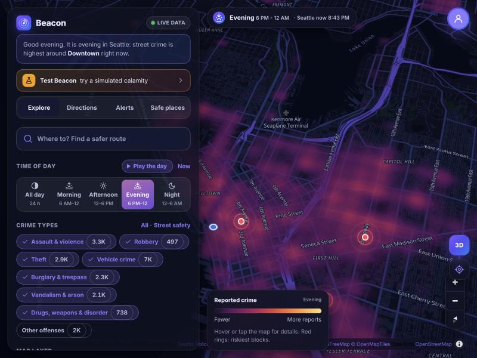
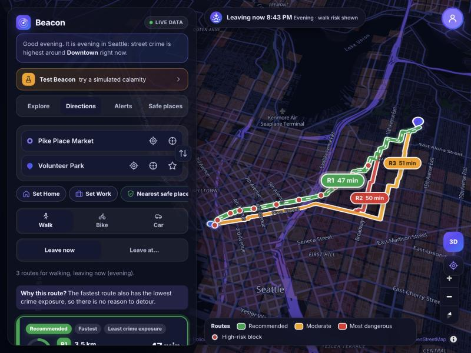
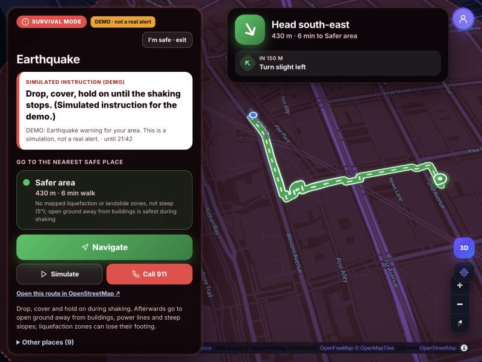
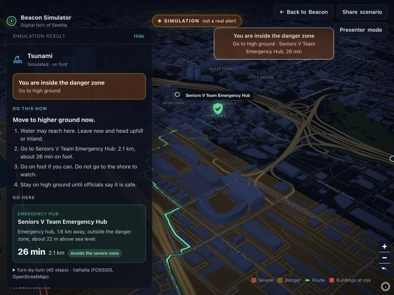

# Beacon

**Know what's happening. Get to safety.**

Beacon is a personal safety app for Seattle, for everyday risks and for emergencies.

- **Every day**, it recommends the **safest reasonable route** for walking, cycling or driving. It accounts for the time you travel, never sends you on a long detour for a tiny gain, and explains every choice.
- **When something serious happens**, such as an earthquake, tsunami, flood, storm, wildfire, chemical leak or an attack, it picks up **official alerts**, tells you **what is happening and what to do**, and **guides you on the map to the nearest suitable safe place**.
- **Before it happens**, it watches free NASA, NOAA and USGS feeds for **calamities that may be coming**, and shows **which areas are most and least exposed**.

Everything runs on **free, open data and open-source software**. No paid APIs, no API keys.

| Explore: crime by time of day | Directions: three routes, scored and explained |
|---|---|
|  |  |
| **Survival mode: guidance on the map** | **Simulator: a digital twin for demos** |
|  |  |

> Beacon is a helper, not a replacement for official emergency alerts. Always follow instructions from local authorities. Risk scores describe reported crime and mapped hazards; they are not a guarantee of safety.

---

## Contents

- [What Beacon does](#what-beacon-does)
- [Try it](#try-it)
- [How it works](#how-it-works)
- [Data sources](#data-sources)
- [Models](#models)
- [Run it locally](#run-it-locally)
- [Repository layout](#repository-layout)
- [API](#api)
- [Principles and honest limits](#principles-and-honest-limits)
- [Roadmap](#roadmap)
- [Where it came from](#where-it-came-from)

---

## What Beacon does

### 1. Explore: where and when crime is reported

- **Heatmap** of four years of Seattle Police reports (about 286,000 offenses) for All day, Morning, Afternoon, Evening or Night, filtered by eight crime groups.
- **Play the day**: animates a full day.
- The whole app switches between **daylight and midnight palettes** with the time of day.
- **Risk grid (ML)**: a gradient-boosting model predicts next-year risk for every ~225 m block in each time band. Shown flat, or as a **3D risk skyline**. Pulsing rings mark the riskiest blocks.
- **Areas ranked**: 58 neighborhoods by a severity-weighted danger index per km². Click one to highlight it.
- **3D city**: building heights from OpenStreetMap and terrain from open elevation data, styled like a modern maps app.

### 2. Directions: the safest reasonable route

- **From and To**: each takes an address search, **My location**, a point picked on the map, Home, Work, a favourite, or the **nearest safe place**.
- **Walk, bike or car**; leave now or at a chosen time.
- **Up to three routes**, scored by crime exposure along the way at the time you'll be there. Green is recommended, orange moderate, red most dangerous.
- **The recommendation rules**:
  - Beacon never switches your travel mode.
  - It suggests a slower route only if it stays within the detour limit (walking: the smaller of 25% or 5 extra minutes) **and** cuts exposure by at least 15%.
  - Every choice comes with a plain-language **Why?**
- **Trip mode**: turn-by-turn directions and a **danger alert** (banner, sound, vibration) before you enter a high-risk block. **Simulate** plays a trip for demos.
- **Places, preferences and trip history** stay in your browser.

### 3. Alerts: official warnings for where you are

- **Government alerts** matched to your location:
  - National Weather Service CAP alerts, which carry many official warnings: tsunami, flood, storms, fire weather, heat, air quality, civil danger and more
  - USGS earthquakes
  - FEMA IPAWS (the Wireless Emergency Alerts system) archive
- **Live incidents nearby** from Seattle Fire's real-time 911 dispatches.
- Each alert shows the sender, the expiry and **the official instructions first**. Alert areas are drawn on the map, and a freshness line shows when each source last updated.

### 4. Survival mode: the map guides you to safety

Survival mode turns on when a severe alert covers your location (Extreme or Severe, Immediate or Expected), or when you turn it on yourself. It then takes over the app:

- **The map stays visible.** It shows where you are, the danger area, the chosen safe place, a bold walking route, and a large direction card such as **"Head south-east · 430 m · 6 min"** with the next turn.
- **Navigate** follows your location turn by turn (only while navigating). **Simulate** plays the walk for demos. **Call 911** is one tap away.
- **A high-contrast sheet** gives the official instruction first, then a short checklist written for that hazard.
- **A DEMO control** shows the mode with a clearly marked fake alert.

### 5. Safe places: the right refuge for the hazard

Seattle has about 350 places from the City's official open data and OpenStreetMap: emergency hubs, assembly points, hospitals, police and fire stations, community centres, shelters and underground stations.

Which places count as safe depends on the hazard:

| Hazard | Where Beacon sends you first |
|---|---|
| Earthquake | Open assembly points and emergency hubs, away from buildings |
| Tsunami, flood | High ground outside the inundation or flood zone, emergency hubs |
| Air raid or attack | Bomb shelters and bunkers, then **underground stations** (Seattle's Link tunnel stations), never social-service shelters |
| Wildfire, smoke, heat | Clean-air and cooling centres (community centres), shelters, hospitals |
| Chemical leak | Shelter in place unless told to evacuate, then hospitals |
| Crime | Places staffed around the clock: police, fire stations, hospitals |

### 6. Hazard outlook: what may be coming, and where is safest

- **Upcoming**: checks free sources for the next ~72 hours and warns when something may affect your area, with the evidence and links. Sources include NASA EONET (open wildfires, storms, volcanoes), GDACS, tsunami.gov, NWS watches, NWS river and tide gauges, SPC storm and WPC rainfall outlooks, Open-Meteo weather and air quality, and USGS.
- **Worst and safest areas**: each block gets an exposure score per hazard from official hazard maps, elevation and distance to a suitable safe place. The maps used:
  - Washington DNR tsunami inundation, for both a Seattle Fault and a Cascadia earthquake
  - Seattle liquefaction and landslide-prone areas
  - FEMA flood zones
  - the USGS Mount Rainier lahar zone
- **Where to go**: the nearest low-exposure area and the best safe place in it. For a tsunami, that means high ground outside the inundation zone.
- **No earthquake forecasts.** Earthquakes cannot be predicted, so Beacon only shows earthquake risk zones and recent USGS activity.

### 7. Simulator: a digital twin for demos

A separate page, **`/simulator.html`**, linked from the app as **Test Beacon**:

- **Pick a calamity**: choose its type, or a preset:
  - M6.8 Seattle Fault earthquake
  - Cascadia tsunami reaching Elliott Bay
  - Discovery Park wildfire
  - SODO chemical leak
  - air raid downtown
  - Duwamish flood
- **Set the scene**: drop yourself and the event on the 3D map, then set the size, the wind, and walk or drive.
- **Run it**: the danger zone spreads over a simulated clock and buildings inside it turn red. Beacon gives the survival guidance and draws an animated route to the right safe place, avoiding the danger zone (Valhalla `exclude_polygons`, falling back to OSRM alternatives).
- **Share scenario**: the scenario is stored in the link itself, so a shared link replays it. Nothing is stored on a server.
- **Presenter mode**: auto-plays the scenario for pitches.
- **Labeling**: everything is marked **SIMULATION, not a real alert**.

---

## Try it

- **Hosted version:** being set up on free tiers (Render + Neon + GitHub Actions). The link will go here. Steps are in [docs/DEPLOY.md](docs/DEPLOY.md).
- **Quick share from your own machine, no account:** run the app locally (below), then run `cloudflared tunnel --url http://localhost:4173` against `vite preview`. This gives a temporary public `trycloudflare.com` link.
- **Offline demo data:** open the web app with `?mock=1` to use built-in mock data, clearly marked MOCK DATA.

---

## How it works

```
                         free open data
  SPD crime ─┐   NWS · USGS · FEMA IPAWS · Seattle Fire 911   NASA EONET · GDACS · tsunami.gov · NOAA · Open-Meteo
             │                  │                                               │
   pipeline/fetch_spd.py   pipeline/ingest_alerts.py              pipeline/outlook_worker.py
   pipeline/load_postgres  pipeline/alerts_worker.py              pipeline/import_hazard_zones.py
   ml/train_risk_model ──► pipeline/import_risk.py                pipeline/import_safe_places.py
             │                  │                                               │
             └──────────────► PostgreSQL + PostGIS (db/schema) ◄────────────────┘
                                         │
                              FastAPI (apps/api)  ── /api/... GeoJSON built in SQL
                                         │
              React + TypeScript + MapLibre GL (apps/web): main app + /simulator.html
                                         │
              OpenFreeMap tiles · AWS Terrain Tiles · OSRM / Valhalla routing · Photon search
```

| Layer | Choice |
|---|---|
| Frontend | React 19, TypeScript (strict), Vite, MapLibre GL 6, OpenFreeMap vector tiles, AWS Terrain Tiles |
| API | Python 3.12, FastAPI, psycopg 3 |
| Database | PostgreSQL 16 + PostGIS 3.4, real geometry columns; a fixed 135 × 80 grid of ~225 m cells over Seattle |
| Background jobs | Plain Python workers locally; GitHub Actions on a schedule when hosted |
| Routing and search | OSRM (routing.openstreetmap.de), Valhalla (FOSSGIS), Photon (komoot) |
| Hosting (free) | One Docker image on Render, Neon Postgres with PostGIS, GitHub Actions |

**Privacy:**
- Your location stays in your browser except for the API calls that need it.
- The API never stores or logs coordinates: the access log redacts them, and point queries are sent `no-store`.
- No account data goes to routing or search services.

---

## Data sources

All free and open. Attribution is shown in the app.

| Data | Source | Used for |
|---|---|---|
| Crime reports, last 4 years | [Seattle Police Department, SPD Crime Data](https://data.seattle.gov/d/tazs-3rd5) | Heatmap, risk model, route scoring |
| Weather and hazard alerts | [National Weather Service API](https://www.weather.gov/documentation/services-web-api) (CAP) | Official alerts, watches |
| Earthquakes | [USGS real-time feeds](https://earthquake.usgs.gov/earthquakes/feed/) | Alerts, aftershock notices, simulator |
| Wireless Emergency Alerts archive | [FEMA OpenFEMA IPAWS](https://www.fema.gov/openfema-data-page/ipaws-archived-alerts-v1) | Alert history; hazard classifier training |
| Real-time 911 dispatches | [Seattle Fire Real Time 911](https://data.seattle.gov/d/kzjm-xkqj) | Nearby incidents |
| Natural events | [NASA EONET](https://eonet.gsfc.nasa.gov/) | Outlook |
| Global disaster alerts | [GDACS](https://www.gdacs.org/) (UN / European Commission) | Outlook |
| Tsunami messages | [tsunami.gov](https://www.tsunami.gov/) (NOAA) | Outlook |
| Storm, rainfall outlooks; river and tide gauges | NOAA SPC, WPC, NWS NWPS | Outlook |
| Forecasts, air quality | [Open-Meteo](https://open-meteo.com/) (free for non-commercial use) | Outlook (rain, heat, wind, smoke) |
| Hazard zones | Washington DNR tsunami inundation; Seattle Environmentally Critical Areas; FEMA National Flood Hazard Layer; USGS Mount Rainier lahar | Worst and safest areas, simulator |
| Elevation | [AWS Terrain Tiles](https://registry.opendata.aws/terrain-tiles/) (Mapzen) | 3D terrain, high ground |
| Safe places | City of Seattle open data (emergency hubs, fire, police, hospitals, community centres); © [OpenStreetMap](https://www.openstreetmap.org/copyright) contributors (ODbL) | Safe places |
| Map tiles | [OpenFreeMap](https://openfreemap.org/), © OpenMapTiles, © OpenStreetMap contributors | Base map, 3D buildings |
| Routing, search | OSRM, Valhalla (FOSSGIS servers), Photon (komoot) | Routes, address search |

Optional: a free NASA FIRMS key (`FIRMS_MAP_KEY`) adds satellite fire hotspots to the outlook. Everything works without it.

---

## Models

**Crime risk model.** `ml/train_risk_model.py`; see the [model card](ml/MODEL_CARD.md).
- Gradient boosting with Poisson loss.
- Predicts expected severity-weighted incidents per year for every ~225 m block in each of the four time bands.
- On the held-out last year it beats simple history (mean of the last two years) on every metric: hotspot capture of the top 10% is 0.63, and Spearman correlation is 0.70.
- Risk levels use the 90th and 97th percentiles of all block-band scores.

**Hazard exposure scores.** `pipeline/hazard_scoring.py`.
- A transparent formula from hazard-zone overlap, elevation and distance to a suitable safe place.
- It is a relative score, not a probability.

**Hazard classifier.** `ml/hazard/`; see the [model card](ml/hazard/MODEL_CARD.md).
- **What it does:** reads free-text emergency messages that carry no official event code and returns the kind of calamity and its severity.
- **Training data:** about 58,000 real FEMA IPAWS alerts from 2012 to 2026, using TF-IDF features and a calibrated linear SVM.
- **Test score (2023 onward, event names masked):** macro-F1 0.69, against 0.44 for keyword matching. Severity macro-F1 is 0.83.
- **Rare hazards:** US alerts contain few earthquakes, tsunamis, volcanoes or attacks, so clear terms such as "aftershock", "eruption" and "air raid" decide those.
- **Not an emergency:** text with no emergency vocabulary returns "other" instead of a guess.
- **Official codes win:** an official event code always overrides the model.

---

## Run it locally

You need Docker, Python 3.12+ and Node.js 20+. The full guide is in [docs/DEVELOPMENT.md](docs/DEVELOPMENT.md).

```bash
python3 -m venv .venv
```

```bash
.venv/bin/pip install -r apps/api/requirements-dev.txt
```

```bash
docker compose up -d db
```

Load the data (about 72 MB download, then a few minutes):

```bash
.venv/bin/python pipeline/fetch_spd.py
```

```bash
.venv/bin/python pipeline/load_postgres.py && .venv/bin/python pipeline/import_risk.py
```

```bash
.venv/bin/python pipeline/import_safe_places.py --seattle-official
```

```bash
.venv/bin/python pipeline/import_hazard_zones.py
```

```bash
.venv/bin/python pipeline/ingest_alerts.py && .venv/bin/python pipeline/outlook_worker.py --once
```

Start the API (http://localhost:8000, docs at `/docs`) and the web app (http://localhost:5173):

```bash
.venv/bin/uvicorn app.main:app --app-dir apps/api --reload --port 8000
```

```bash
npm --prefix apps/web install && npm --prefix apps/web run dev
```

Run the tests:

```bash
cd apps/api && ../../.venv/bin/python -m pytest -q
```

```bash
npm --prefix apps/web run build
```

On a python.org build of Python on macOS, HTTPS downloads may need `SSL_CERT_FILE=$(.venv/bin/python -m certifi)`.

---

## Repository layout

| Path | What it is |
|---|---|
| `apps/web` | React + TypeScript + MapLibre app: the main app (`index.html`) and the simulator (`simulator.html`) |
| `apps/api` | FastAPI app: map data, alerts, safe places, outlook, simulation; tests in `apps/api/tests` |
| `db/schema` | PostgreSQL + PostGIS schema, applied on first start of the database container |
| `pipeline/` | Data download and loading: crime, ML risk import, alerts, safe places, hazard zones, outlook, publishing to a hosted DB |
| `ml/` | Crime risk model and hazard classifier, with model cards |
| `docker-compose.yml`, `Dockerfile`, `render.yaml`, `.github/workflows/` | Local database, production image, free hosting, CI and scheduled data refresh |
| `docs/` | [Development](docs/DEVELOPMENT.md), [deployment](docs/DEPLOY.md), API contract and class-project documents |
| `CrimeRadar/`, `sql/`, `scripts/`, `tools/`, `poster/`, `project-plan/` | The original CrimeRadar class app (Java/JSP/MySQL), kept as a reference |

---

## API

All endpoints are read-only and return JSON or GeoJSON. There's interactive documentation at `/docs`.

| Endpoint | Returns |
|---|---|
| `GET /api/health` | API and database status |
| `GET /api/meta` | Data range, totals, grid, time bands, crime groups, travel modes, risk thresholds, active model |
| `GET /api/heatmap?band=&groups=` | Crime counts per block as GeoJSON points |
| `GET /api/risk?band=` | ML risk per block as GeoJSON polygons |
| `GET /api/grid`, `GET /api/neighborhoods` | Class-app data contract: per-block counts and risk; ranked neighborhoods |
| `GET /api/alerts/active?lat&lng` | Alerts covering a point, nearby incidents, and whether survival mode applies |
| `GET /api/alerts?bbox=`, `GET /api/alerts/status` | Active alert areas for the map; per-source freshness |
| `GET /api/hazards` | Hazard list with the kinds of safe place for each |
| `GET /api/safe-places?bbox=&kinds=`, `GET /api/safe-places/nearest?lat&lng&hazard` | Safe places on the map; nearest suitable places |
| `GET /api/outlook?lat&lng`, `GET /api/outlook/areas`, `GET /api/outlook/sources` | What may be coming, its areas, and source status |
| `GET /api/hazard-zones?hazard=&bbox=`, `GET /api/hazard-grid?hazard=` | Official hazard zones; per-block exposure from worst to safest |
| `GET /api/safe-areas?lat&lng&hazard` | Where to go: nearest low-exposure areas and safe places |
| `POST /api/simulate` | Simulator: affected area, user status, guidance, destination and a route that avoids the danger |
| `POST /api/hazard/classify`, `GET /api/hazard/model` | Hazard classifier for free-text messages; model version and metrics |

---

## Principles and honest limits

- **Safest reasonable route.** Beacon never switches your travel mode, never suggests a detour beyond your limit, detours only for a meaningful gain, and always explains why.
- **Act, not panic.** Official instructions come first, then short, plain steps.
- **Honest data:**
  - Freshness is shown, and missing data is never treated as safe.
  - Police data shows reported crime, not all crime. About half of crimes against persons have no public location.
  - The FEMA archive runs about a day behind.
  - Simulator results are rules of thumb and are labeled as simulated.
- **Fair.** Scores must not be used to label or stigmatize neighborhoods.
- **Private.** Location is used only for the feature in use, never stored or logged, and never sold.
- **Not a replacement.** Beacon does not replace Wireless Emergency Alerts, 911 or instructions from authorities.

---

## Roadmap

Done and planned features are listed in [ROADMAP.md](ROADMAP.md). Next up:
- the walk-me-home check-in timer
- event-aware risk
- lighting-aware night routing
- personal risk profiles
- the safest departure time
- the free hosted version

---

## Where it came from

Beacon grew out of **CrimeRadar**, our CS 5200 Database Management Systems project at Northeastern University: a Seattle crime-safety app on a MySQL model of SPD data. CrimeRadar is a separate project with its own repository, [rajryadav4/CrimeRadar](https://github.com/rajryadav4/CrimeRadar). This repo started as a copy of it, and the original Java app stays in `CrimeRadar/` as a reference ([docs/CLASS_PROJECT.md](docs/CLASS_PROJECT.md)).

**Team:** Raj Ranjit Yadav, Trevor Kkhaya, Purvesha Kolhe.
