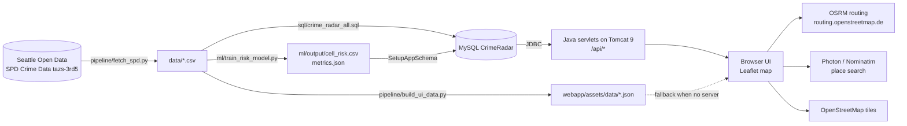
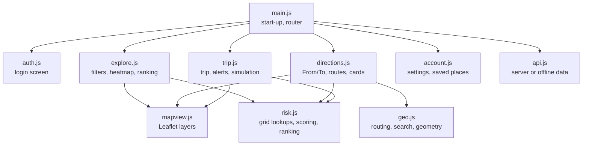
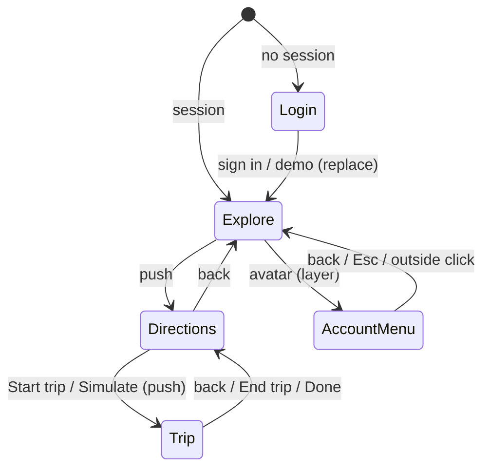

# CrimeRadar architecture

## Overview

| Part | Where | Job |
|---|---|---|
| Data fetch | `pipeline/fetch_spd.py` | Downloads the last 4 years from the SODA API into the CSV format that the SQL loader reads. |
| Database | `sql/crime_radar_all.sql`, `sql/app_tables.sql` | Milestone tables (14) plus the app layer: crime groups, grid cells, summary tables, model output, user places, preferences, trips. See [DATABASE.md](DATABASE.md). |
| ML model | `ml/train_risk_model.py` | Predicts next-year risk per grid cell and time band. See [ml/MODEL_CARD.md](../ml/MODEL_CARD.md). |
| Static data | `pipeline/build_ui_data.py` | Writes the same map JSON as the API, for offline use. |
| Backend | `CrimeRadar/src/main/java` | Servlets for map data, accounts, places, trips. JDBC DAOs. |
| Frontend | `CrimeRadar/src/main/webapp` | `index.html`, `assets/css/app.css`, `assets/js/*.js` (ES modules, no build step). |

The contract between the parts is [API.md](API.md).

## Frontend modules

Navigation has one owner (the router in `main.js`):

## How the risk works

1. **Grid**: Seattle is split into cells of about 225 m x 225 m (`cellId = row * 100 + col`).
2. **Time bands**: Night (0-6), Morning (6-12), Afternoon (12-18), Evening (18-24), Seattle time.
3. **Crime groups**: 8 groups with a severity weight (robbery 4, assault 3, ... other 0.25).
4. **Model**: a gradient-boosting model with Poisson loss predicts the severity-weighted incidents per year for each cell and band, from the previous two years of the cell, its neighbors and its neighborhood.
5. **Levels**: Elevated = top 10% of cell-bands in Seattle, High = top 3%. One threshold set for all bands, so evening shows more red than morning.
6. **Routes**: OSRM returns up to 3 routes (plus 2 detour candidates). The browser samples each route every 25 m, takes the time-weighted mean cell risk at the departure band, and multiplies it by the travel-mode exposure (walk 1.0, bike 0.7, car 0.3). The 0-100 score is a log scale up to the riskiest block-time in Seattle. Ranking = `w x risk + (1 - w) x time`, with `w` from the user's "Route choice".
7. **Alerts**: during a trip, CrimeRadar checks the block ahead (60 m and 120 m) and the current block. A high-risk block starts an alert (once per area).

## Map engines

`mapview.js` picks the engine at start-up. Both have the same interface (`setHeat`, `setGrid`, `drawRoutes`, `fit`, `flyTo`, `popup`, ...), so the views do not know which one runs.

| Engine | File | When | What it adds |
|---|---|---|---|
| MapLibre GL 4.7.1 + OpenFreeMap "positron" vector tiles | `mapview-gl.js` | WebGL works and the style loads in 6 s | Own day/night palettes with 0.9 s color fades, GPU heatmap that glides between times, 3D risk skyline (`fill-extrusion`), 3D buildings, glowing routes with a moving dash, radar blips, slow 3D orbit behind the sign-in card |
| Leaflet 1.9.4 + OpenStreetMap raster tiles | `mapview-leaflet.js` | No WebGL, the GL library or the style service fails, or `?map=leaflet` | Everything except 3D and the orbit; CSS filters make the tiles muted by day and dark at night |

Shared colors and the route-label layout are in `mapstyle.js`.

## Visual design

- Frosted-glass panels over a live map, with a violet-to-cyan brand gradient.
- The theme follows the clock: for Evening and Night the app and the map turn dark (`body.theme-night`, CSS variables in `app.css`).
- Heatmap: a sequential "fire" ramp whose lightness changes in one direction only (darker = more on the light map, brighter = more on the dark map).
- Risk levels always show an icon and a label, never color alone. Score rings, route glow and the danger banner animate; `prefers-reduced-motion` turns the animations off.

## Offline mode

If `api/health` does not answer, the UI runs on `assets/data/*.json` and keeps accounts in the browser tab
(`sessionStorage`, salted PBKDF2; they end when the tab closes, so a shared laptop keeps no visitor data). The pill in the panel shows **Offline data** or **Live DB**. Start the UI without Tomcat with `python tools/serve_ui.py`.

## External services (free, no API key)

| Service | Use | Fallback |
|---|---|---|
| OpenFreeMap vector tiles (`tiles.openfreemap.org`) | Main base map, recolored in the browser | OpenStreetMap raster tiles (Leaflet engine) |
| OpenStreetMap tiles | Fallback base map (CSS filter for the muted and night styles) | - |
| OSRM `routing.openstreetmap.de` | Walk, bike and car routes | Error card with "Try again" |
| Photon `photon.komoot.io` | Place search while typing | Nominatim, then saved places and landmarks |
| Browser geolocation | Start point, live alerts | Pike Place Market as demo start; Simulate |

Privacy: these services see what they need to do their job. OSRM gets the start and end coordinates of a
route (this can be the device location or a saved Home or Work). Photon and Nominatim get the text typed in
the search boxes. They get no account data, no names and no emails. Saved places and trips stay in the
CrimeRadar database.

## Security

- Passwords: PBKDF2-HMAC-SHA256 with a random salt (old SHA-256 seed hashes are upgraded at login).
- Session cookie `HttpOnly`, `SameSite=Lax`; the session id changes at login.
- Every `POST`/`DELETE` needs the header `X-CrimeRadar: 1` (CSRF guard). Login is rate-limited.
- The UI writes user text with `textContent` only (no HTML injection).
- `db.properties` (MySQL password) is git-ignored.
