# CrimeRadar database

MySQL 8.0, schema `CrimeRadar`. Two layers:

1. **Milestone tables** (14). Built by `sql/crime_radar_all.sql`. They hold the raw SPD data.
2. **App tables** (14 tables + 1 view). Built by `sql/app_tables.sql`. They hold small summary tables, the ML risk scores and the user data.

The web app never scans `CrimeIncidents` (about 319,000 rows) while serving a request.
`app_tables.sql` reads it once and writes small summary tables. The API reads only those.

## Rebuild commands

Run from the repository root. Needs MySQL running and your password in `CrimeRadar/src/main/java/db.properties`.

| Goal | Command |
|---|---|
| First setup, or refresh the summary tables | `scripts\setup-db.ps1` |
| Load new ML output only (`ml/output/`) | `scripts\setup-db.ps1 --risk-only` |
| Also wipe saved places, trips and preferences | `scripts\setup-db.ps1 --reset` |
| Re-run the milestone script `crime_radar_all.sql` | first `scripts\setup-db.ps1 --drop-only`, then the milestone script, then `scripts\setup-db.ps1` |
| Run any SQL (no mysql client needed) | `scripts\sql.ps1 "SELECT COUNT(*) FROM CellStats"` |

Why `--drop-only` first: the app tables point at milestone tables (`AppUsers`, `RouteRecommendations`).
MySQL will not drop a table that another table points at.

`setup-db.ps1` is safe to run again. It does four things:

1. Runs `sql/app_tables.sql`. Summary tables are dropped and rebuilt (about 15 seconds).
   User tables use `CREATE TABLE IF NOT EXISTS`, so saved places and trips survive.
2. Imports `ml/output/cell_risk.csv` and `ml/output/metrics.json` if they exist.
3. Creates the demo account `demo@crimeradar.app` / `CrimeRadar2026!` with a Home and a Work place.
4. Prints the row count of every app table. If MySQL refuses the login, it prints a clear message and exits with code 2.

The running web app notices new summary tables or a new model within 30 seconds. No restart is needed.

## ER diagram

```mermaid
erDiagram
    DataSources ||--o{ CrimeIncidents : source
    CrimeCategories ||--o{ CrimeIncidents : category
    Neighborhoods ||--o{ CrimeIncidents : in
    PolicePrecincts ||--o{ CrimeIncidents : in
    PolicePrecincts ||--o{ Neighborhoods : has

    CrimeCategories ||--o| CategoryGroups : "maps to (excluded: no row)"
    CrimeGroups ||--o{ CategoryGroups : group

    GridCells }o--o| Neighborhoods : "dominant"
    GridCells ||--o{ CellStats : cell
    CrimeGroups ||--o{ CellStats : group
    TimeBands ||--o{ CellStats : band
    Neighborhoods ||--o{ NeighborhoodStats : has
    CrimeGroups ||--o{ NeighborhoodStats : group
    TimeBands ||--o{ NeighborhoodStats : band
    Neighborhoods ||--o| NeighborhoodPrecincts : "main precinct"
    PolicePrecincts ||--o{ NeighborhoodPrecincts : precinct

    ModelRuns ||--o{ CellRiskScores : scores
    GridCells ||--o{ CellRiskScores : cell
    TimeBands ||--o{ CellRiskScores : band

    AppUsers ||--o| UserPreferences : has
    AppUsers ||--o{ UserPlaces : saves
    AppUsers ||--o{ RouteRecommendations : requests
    Routes ||--o{ RouteRecommendations : route
    RouteRecommendations ||--o| TripDetails : "1 to 1"
    TravelModes ||--o{ UserPreferences : mode
    TravelModes ||--o{ TripDetails : mode

    AppUsers ||--o{ EmergencyContacts : has
    AppUsers ||--o{ SOSAlerts : sends
    Routes ||--o{ RouteSegments : has
```

## Milestone tables (from `crime_radar_all.sql`)

| Table | Rows | Used by the app? |
|---|---|---|
| `CrimeIncidents` | 319,029 | Only to build the summary tables |
| `CrimeCategories` | 64 | Yes, mapped to crime groups |
| `Neighborhoods` | 61 | Yes |
| `PolicePrecincts` | 7 | Yes |
| `DataSources` | 2 | Yes (source name for `api/meta`) |
| `AppUsers` | 1,000 sample users + demo | Yes (login, register) |
| `Routes` | 5,000 sample | Only trips saved by users (new rows) |
| `RouteRecommendations` | 5,000 sample | Only trips saved by users (new rows) |
| `RiskScores`, `EmergencyCalls`, `SafetyResources`, `SOSAlerts`, `EmergencyContacts`, `RouteSegments` | generated samples | No |

Row counts are from the scratch test load of the full SPD file.

## App tables (from `app_tables.sql`)

| Table | What it holds | Key |
|---|---|---|
| `CrimeGroups` | 8 crime groups and their severity | `GroupId` |
| `TimeBands` | 4 six-hour bands | `BandId` |
| `TravelModes` | walk, bike, car and vulnerability | `ModeKey` |
| `CategoryGroups` | Offense category to crime group. Excluded offenses have no row | `CategoryId` |
| `GridCells` | One row per map cell that has data: row, column, centre, dominant neighborhood | `CellId` |
| `CellStats` | Incident counts per cell, band and group (about 53,000 rows) | `CellId, TimeBand, GroupId` |
| `NeighborhoodStats` | Counts per neighborhood, band and group, plus coordinate sums for the mean position | `NeighborhoodId, TimeBand, GroupId` |
| `NeighborhoodPrecincts` | The precinct that reports most of a neighborhood | `NeighborhoodId` |
| `AppMeta` | Totals, data dates, build time (`api/meta` reads it) | `MetaKey` |
| `ModelRuns` | One row per ML model run. Only one is active | `ModelVersion` |
| `CellRiskScores` | Expected risk and level per cell and band, per model | `ModelVersion, CellId, TimeBand` |
| `UserPreferences` | Mode, safety weight, alerts (1:1 with `AppUsers`) | `UserId` |
| `UserPlaces` | Home, work and saved places | `PlaceId` |
| `TripDetails` | Labels, mode, time and risk of a saved trip (1:1 with `RouteRecommendations`) | `RecommendationId` |
| `vw_CleanIncidents` (view) | Wanted incidents with `GroupId`, `TimeBand`, `CellId` | - |

Design choices:

- **One active model.** `ModelRuns.ActiveKey` is 1 for the active run and NULL for the others.
  A UNIQUE index on it allows only one active run (NULLs do not collide).
- **One home and one work per user.** `UserPlaces.SingleKind` is NULL for saved places.
  A UNIQUE index on `(UserId, SingleKind)` allows one HOME and one WORK. A new home replaces the old one.
- **A trip is three rows in one transaction:** `Routes`, `RouteRecommendations`, `TripDetails`.
- **Constraints.** Grid cells must satisfy `CellId = RowIdx * 100 + ColIdx` with 135 rows and 80 columns.
  Risk, weights, counts and scores have CHECK constraints. User tables use `ON DELETE CASCADE`.
- **Lookup tables instead of ENUMs** for crime groups, bands and modes, so the facts are rows you can join.

## What the app ignores, and why

| Ignored | Why |
|---|---|
| Offenses `Not Reportable to NIBRS` and `Justifiable Homicide` (33,212 rows) | Not crimes. They have no row in `CategoryGroups`, so every join drops them |
| Neighborhoods `-`, `UNKNOWN`, `OOJ`, `FK ERROR` | Not real places. Not ranked and not used as a cell's neighborhood |
| Incidents without coordinates, or outside the grid | They cannot be drawn. They still count in their neighborhood's totals |
| Incidents at exactly `00:00:00` (24,641 rows) | The time of day is unknown. Left out of `CellStats` and `NeighborhoodStats`. They stay in `totals.incidents` |
| `RiskScores`, `EmergencyCalls`, `SafetyResources`, `SOSAlerts`, 5,000 sample `Routes` | Generated sample data for the course. Not real |

Offense groups come from `pipeline/category_groups.csv`. `app_tables.sql` has a copy of those rows inline.
A new offense description that is not in the list goes to the group `other`.

## Indexes

Only the indexes the API needs, plus the foreign key indexes MySQL requires.

| Table | Index | Used for |
|---|---|---|
| `CellStats` | primary key `(CellId, TimeBand, GroupId)` | `api/grid`: ordered scan, no sort |
| `GridCells` | primary key `CellId`; `UNIQUE (RowIdx, ColIdx)`; `NeighborhoodId` | `api/grid`; cells per neighborhood |
| `CellRiskScores` | primary key `(ModelVersion, CellId, TimeBand)` | `api/grid`: range on one model |
| `NeighborhoodStats` | primary key `(NeighborhoodId, TimeBand, GroupId)` | `api/neighborhoods` |
| `ModelRuns` | `UNIQUE (ActiveKey)` | find the active model by index |
| `AppMeta` | primary key `MetaKey` | `api/meta`, cache signature |
| `AppUsers` | `UNIQUE (Email)` (milestone) | login |
| `UserPlaces` | `UNIQUE (UserId, SingleKind)`; `(UserId, CreatedAt)` | list, replace home/work, delete |
| `RouteRecommendations` | `(UserId, RequestedAt)` (added by `app_tables.sql`) | "my newest trips" without a sort |
| `UserPreferences`, `TripDetails` | primary key | 1:1 lookups |

### EXPLAIN results (scratch database with the full data)

None of these queries reads `CrimeIncidents`.

| API query | Access | Key |
|---|---|---|
| Grid counts: `SELECT ... FROM CellStats ORDER BY CellId, TimeBand, GroupId` | full index scan, no filesort | `PRIMARY` |
| Grid cells: `SELECT CellId, NeighborhoodId FROM GridCells ORDER BY CellId` | full index scan, no filesort | `PRIMARY` |
| Risk: `... FROM CellRiskScores WHERE ModelVersion = ? ORDER BY CellId, TimeBand` | `ref` | `PRIMARY` |
| Neighborhoods: `NeighborhoodStats` join `Neighborhoods`, `NeighborhoodPrecincts`, `PolicePrecincts` | `ref` and `eq_ref` | `PRIMARY` on each |
| Active model: `... FROM ModelRuns WHERE ActiveKey = 1` | `const` | `uq_ModelRuns_OneActive` |
| Meta value: `... FROM AppMeta WHERE MetaKey = ?` | `const` | `PRIMARY` |
| Login: `... FROM AppUsers WHERE Email = ?` | `const` | `Email` |
| Places list: `... FROM UserPlaces WHERE UserId = ? ORDER BY ...` | `ref` (small sort of one user's rows) | `uq_UserPlaces_OnePerKind` |
| Place delete: `DELETE ... WHERE PlaceId = ? AND UserId = ?` | `range` | `PRIMARY` |
| Trips list: `RouteRecommendations` join `TripDetails`, `Routes` WHERE `UserId = ?` newest first, `LIMIT 10` | `ref`, backward index scan, then `eq_ref` | `ix_RouteRecommendations_UserTime`, `PRIMARY` |
| Preferences: `... FROM UserPreferences WHERE UserId = ?` | `const` | `PRIMARY` |

## How the app uses the database efficiently

- **Summary tables.** Map requests read tables of about 4,000 cells and 60 neighborhoods, not 319,000 incidents.
- **Cache in memory.** `MapDataCache` builds `api/meta`, `api/grid` and `api/neighborhoods` once.
  It keeps the plain bytes and a gzip copy. A request costs no database work.
  One cheap lookup at most every 30 seconds checks whether the tables or the model changed.
- **gzip and ETag.** The grid is about 418 KB plain and 107 KB gzipped. Repeat visits get `304 Not Modified`.
- **Prepared statements** everywhere. Passwords are hashed with PBKDF2 (150,000 rounds, random salt).
- **Open point.** The existing `ConnectionManager` opens a new connection per call (no pool, because no new jars are allowed).
  This is fine for an exhibition. A connection pool would be the next step.

## Data sync (twice a day)

`scripts\sync.ps1` keeps the database fresh from the Seattle open data API (dataset `tazs-3rd5`).
It runs `crimeradar.tools.SyncIncidents`. Steps:

1. Find the newest `ReportedAt` in `CrimeIncidents`. Ask the API for offenses reported since then minus 21 days (reports arrive late). Pages of 20,000 rows. The request has a generic `User-Agent` and no personal data.
2. Clean each row with the same rules as `crime_radar_all.sql` (dates, lat/lng ranges, `-` becomes `UNKNOWN`, one row per report and offense).
3. Insert only new rows. The key `UNIQUE (SourceId, SourceOffenseId)` (report number + `-` + offense id) ignores rows that are already there. Missing precincts, neighborhoods and categories are created. A new category gets its crime group by the same rules as `CategoryGroups` (same description as an old category, then `pipeline/category_groups.csv`, else `other`; `exclude` gets no group row).
4. Delete incidents older than 4 years.
5. Rebuild the summary tables with the REFRESH part of `sql/app_tables.sql`, in one transaction. Readers see the old numbers until it commits. It also sets `AppMeta.builtAt`, so the running web app reloads within 30 seconds.

It prints rows fetched, inserted, removed and the new totals. Exit codes: 0 ok, 2 database error, 3 API error.
Output is also saved in `logs\sync.log`. A run takes about 40 seconds.

`scripts\sync.ps1 -Retrain` also runs `pipeline/fetch_spd.py`, `ml/train_risk_model.py`, `pipeline/build_ui_data.py` and `scripts\setup-db.ps1 --risk-only`. The static JSON and the model stay in step with the database.

The schedule is set up by you with Windows Task Scheduler. The exact `schtasks` commands (06:00 and 18:00) are in the header of `scripts\sync.ps1`.

Tested on the scratch database: 2,000 newest incidents deleted, the sync inserted exactly 2,000, a second run inserted 0, and `api/meta` matched the database after the cache refresh.
